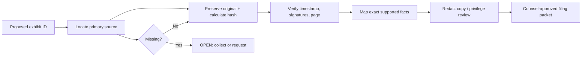

# Proposed exhibit coverage tracker

This is the V5 exhibit matrix, not an inventory of authenticated files in this repository.

| Exhibit | Specific proof sought | Current source status |
|---|---|---|
| A | October 7, 2019 baseline physician statement | Identified; authenticate |
| B | October 8, 2019 emergency report, radiology and EMS | Identified; pinpoint-page check |
| C | February–July 2020 clinical record | Identified; causation reserved |
| D | Complaint, guardian ad litem application and order | Identified; complete order needed |
| H | April–May 2024 synchronized medical chronology | Retrospective dates require qualification |
| I | April 22 withdrawal motions and proof of service | Incomplete proof pages; verify filed copies |
| J | April 30 encounter; Alcaraz and witnesses | Declarations and accurate time basis needed |
| K | May 1 native email, PDFs, scan and custody | Verify original files, signatures, metadata |
| L | May 9 notice reporting unconditional settlement | Compare authenticated court filing |
| M | Minute order vacating trial and notice evidence | Confirm entry and recipients |
| N | Death record, guardian records and successor capacity | Death certificate and capacity documentation needed |
| O | Complete post-death docket and instructions | Not yet integrated |
| P | Settlement, trust, Medicare and other financial transactions | Full reconciliation needed |
| Q | December dismissal request and clerk entry | Examine original form and docket |
| R | Objections and later solicitations/communications | Dates and full message chains needed |
| S | December 2025 motion, 2026 motions, opposition, rulings | **Essential before renewed filing** |
| T | Discovery-of-dismissal and diligence chronology | **Essential for equitable relief** |
| U | Occurrence evidence, witness, video and police records | For meritorious-claim showing |
| V | Witness declarations, personal knowledge | Essential to contested April 30 events |

**Priority gaps:** Obtain full 2025–2026 filings and rulings (S), actual dismissal discovery/diligence dates (T), original instruments/email chain (K), sworn firsthand witnesses (J/V), guardian appointment and compromise order if any (D/N), and financial trace (P/R). Current descriptions do not substitute for primary evidence.
