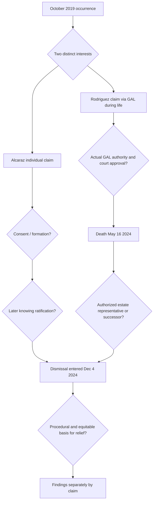

# Separate claims, authority, and proof questions

## Question-to-proof matrix

| Question | Primary proposed sources | Do not assume |
|---|---|---|
| What happened during April 30 signing and immediate response? | J, V, native originals | A physical signature alone answers every subsequent authority dispute. |
| What was scanned, signed, sent and when? | K, original releases, email headers, scanner logs | Scan time equals handwritten signature time. |
| Was Rodriguez's compromise validly approved? | D, N, approval petition/order if any | A settlement notice is a judicial approval order. |
| Who had lawful authority after death? | N, O, appointment/successor papers | Prior GAL status automatically continues post-death. |
| What happened to money and did conduct ratify the transaction? | P, R, trust ledger, bank/check records | A Medicare payment by itself proves ratification or misappropriation. |
| Was dismissal procedurally reviewable on the actual motion history? | Q, S, T, full rulings | Time limits or prior rulings can be ignored. |

**Source framing:** This is a map of disputed issues in the supplied V5 draft, not a determination that a contract failed to form or that a court will grant relief. The full 2025–2026 motion/ruling record is essential to assess the procedural route.
