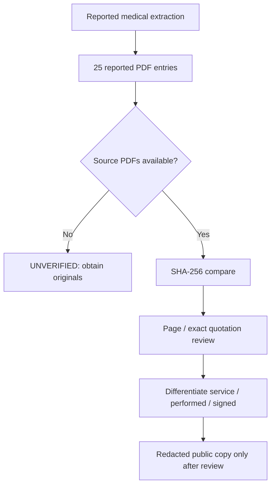

# Medical source register and temporal integrity

The supplied V5 draft reports **25 clinical text/metadata extracts** and lists purported original PDF names and SHA-256 values. **None of those original PDF bytes were supplied in this repository build**. Do not claim those hashes were verified against original PDFs.

Key times in V5: **May 13, 2024**, tracheostomy exchange around 7:30 am described in an RT note with service time 9:26 am, performed 9:28 am and electronically signed **May 27**. **May 15, 6:39 pm** note describes family at bedside. **May 16, 6:20 am** note records comfort setting adjustments. **May 16, 7:06 pm** service note describes family at bedside until death, but **does not certify time of death**.

| ID | Reported PDT service time | Reported PDF filename | SHA-256 in extract (not independently verified) |
|---|---|---|---|
| MED-01 | 5/11/2024 07:22 PDT | Intensive Care Unit Daily Progress Note - 16037047963.pdf | `b41928e9fc45cb891c416d808c552ca68b458e53aed25ff9f0c69c8466ad9799` |
| MED-02 | 5/11/2024 11:50 PDT | Nephrology Inpatient Progress Note - 16039817856.pdf | `b315a5b4498d53245d65439c1be8aad583f013b4e6d7f548aeb57b00643ecd1d` |
| MED-03 | 5/11/2024 18:07 PDT | Respiratory Therapy Inpt. Progress Note - 16039166398.pdf | `769c6419fe5fe7902a84fa398f12d9141d19206c6fa7e2f91442a72b2bcc8440` |
| MED-04 | 5/12/2024 06:23 PDT | Respiratory Therapy Inpt. Progress Note - 16040971992.pdf | `71a1c743be319b5765bdb4e804293ab85f9fa282d91a79cfc336f8314cae2a11` |
| MED-05 | 5/12/2024 09:49 PDT | Intensive Care Unit Daily Progress Note - 16041702324.pdf | `39f497b71b7ea3298a39d4ce0b65d113356957c4b16bb9feaf448d629549a92f` |
| MED-06 | 5/12/2024 10:06 PDT | Nephrology Inpatient Progress Note - 16042596089.pdf | `67a12ff6b5f910bd0f6c22889a4ec1d5d6eb696eaff1ce7ea0e748e0e8887d40` |
| MED-07 | 5/12/2024 17:29 PDT | Respiratory Therapy Inpt. Progress Note - 16042909589.pdf | `db9193001a2e01af258cc286144672ae0592dffaf760af4b121ba61e258819e8` |
| MED-08 | 5/13/2024 06:31 PDT | Respiratory Therapy Inpt. Progress Note - 16044839242.pdf | `af16e0381623b81f569200c2d14acf46a12da8b7fa78c4040b5080aece178a2c` |
| MED-09 | 5/13/2024 07:56 PDT | Nephrology Inpatient Progress Note - 16045130673.pdf | `72ed2e5b833753fdc4da782a310ff2d9dd3b0ca2798de24b9e666dd147d7b4bf` |
| MED-10 | 5/13/2024 07:57 PDT | ENT Inpatient Progress Note - 16045204432.pdf | `bb30b4656cada1641e54b4ca58d1fb6f1233dcc48004294f97f0b553b9a15a33` |
| MED-11 | 5/13/2024 08:12 PDT | Neurology Inpatient Progress Note - 16046175058.pdf | `f2dcd9a627cec57cbcfdc3b6c085edb18e3a20d171c7c456fbd63f5c15e35710` |
| MED-12 | 5/13/2024 09:16 PDT | Intensive Care Unit Daily Progress Note - 16047755847.pdf | `aefd132bcc6ac347f2ddd33bbc7d06042506fb66ab862348f40689891b3c19fe` |
| MED-13 | 5/13/2024 09:26 PDT | Respiratory Therapy Inpt. Progress Note - 16045924236.pdf | `9d913d6584773e7bdb4077abe0b99d062f6eacc3ede977d85057666dc197276e` |
| MED-14 | 5/13/2024 16:38 PDT | NutritionDietary Inpatient Progress Note - 16049007277.pdf | `adb74b7c44e2544c1bbb7a3b6f2291e78b8351a4aaf573c514addd2125555dc7` |
| MED-15 | 5/14/2024 06:46 PDT | Respiratory Therapy Inpt. Progress Note - 16051579018.pdf | `440659f44595b962727118537b4d71f939f1a34032ec1753b229ac6ff8e7e761` |
| MED-16 | 5/14/2024 10:01 PDT | Intensive Care Unit Daily Progress Note - 16053382936.pdf | `f89140c4e5c3c528c0fca661e7422827f5b9155d0e79996b577c5c87d3302b56` |
| MED-17 | 5/14/2024 10:26 PDT | Nephrology Inpatient Progress Note - 16053225981.pdf | `032ef15eb5ec00453ed828447d92175b94b361889ee0d4721f24b1689d4f6f7e` |
| MED-18 | 5/14/2024 18:47 PDT | Respiratory Therapy Inpt. Progress Note - 16056433665.pdf | `7958303f94f9bf2cedea8e26e3545c745482440ce3e110c24540765bb5998486` |
| MED-19 | 5/15/2024 06:30 PDT | Respiratory Therapy Inpt. Progress Note - 16058823442.pdf | `e5fd539b67b7795d44dd02e1a96f397b2617621561631d0c91f9282322b28e5a` |
| MED-20 | 5/15/2024 16:18 PDT | Intensive Care Unit Daily Progress Note - 16063164045.pdf | `eebb36d1fdc8627fab7930496f4b42e6f19ebd0d4c0ab7cb0fa68a5ce1af31e8` |
| MED-21 | 5/15/2024 18:39 PDT | Respiratory Therapy Inpt. Progress Note - 16063761411.pdf | `b912ea373213c66cbddae697946b80466969f809b0482beac29fd8d606a5b512` |
| MED-22 | 5/16/2024 06:20 PDT | Respiratory Therapy Inpt. Progress Note - 16065873051.pdf | `b63d323a91384f92788e25d5f268082f79075e318a145549ee5d2c369b38067f` |
| MED-23 | 5/16/2024 08:48 PDT | NutritionDietary Inpatient Progress Note - 16066718374.pdf | `c2315cbebc62dab948147c2abb25b73135eebc2663c2e16aee35d8d2cfb84808` |
| MED-24 | 5/16/2024 15:05 PDT | Intensive Care Unit Daily Progress Note - 16069579886.pdf | `853807ac07da4e36c1ee350a89ec1dc59ec7c153938b867e5360ec942cedfa7e` |
| MED-25 | 5/16/2024 19:06 PDT | Respiratory Therapy Inpt. Progress Note - 16070718020.pdf | `cb35c2d8f87c5e953b76ab4c512074a868a63e44e5d34b40b553ef3a4005cdbe` |
