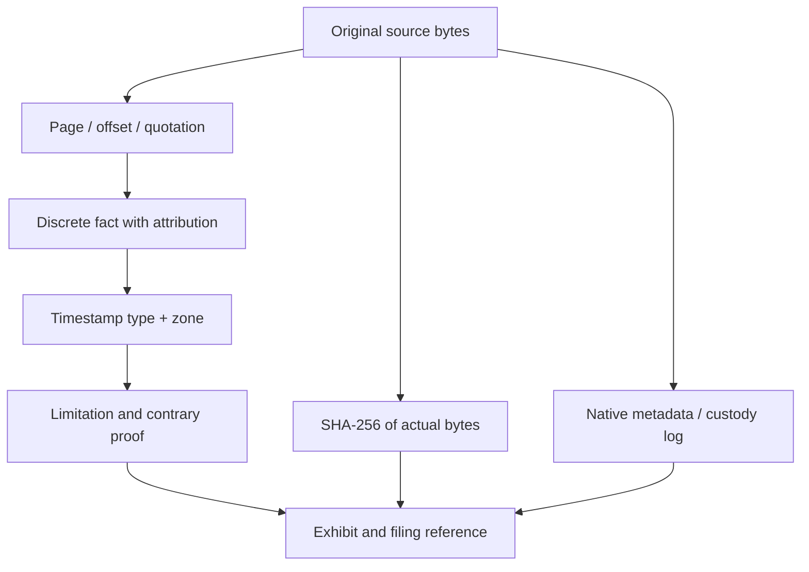

# Evidence provenance, authentication, and privacy

## Traceability chain



Recommended fields per future verified fact:

```json
{
  "fact_id": "FACT-0001",
  "proposition": "Describe an exact bounded proposition",
  "source_id": "EX-K-001",
  "source_filename": "original filename",
  "source_sha256_verified": null,
  "page": null,
  "quote_exact": null,
  "timestamp_local": null,
  "timezone": "America/Los_Angeles",
  "timestamp_kind": "service|performed|signed|scan|sent|filed|reported|unknown",
  "classification": "DOCUMENT|ALCARAZ_ACCOUNT|OPEN",
  "authentication_status": "UNVERIFIED",
  "limitations": ["Identify what the source cannot establish"],
  "contrary_sources": []
}
```

## Guardrails

- **Never replace original bytes** with OCR, redacted, converted or normalized copies. Save derivatives separately.
- A reported SHA-256 from an extraction is **not** an independently verified original-file hash.
- Preserve time zones and kind of timestamp; do not transform a medical service timestamp into time of death.
- Firsthand account and referenced document descriptions must remain attributed until verified, and unresolved material remains **OPEN**.
- Medical information, personal identifiers and financial records require access control, a purpose-limited disclosure review, and applicable filing protections. `.gitignore` reduces accidental Git commits but **is not encryption or access control**.
- Avoid public remote pushes containing clinical documents or full unredacted evidence. Do not submit the full internal repository as an exhibit automatically.
