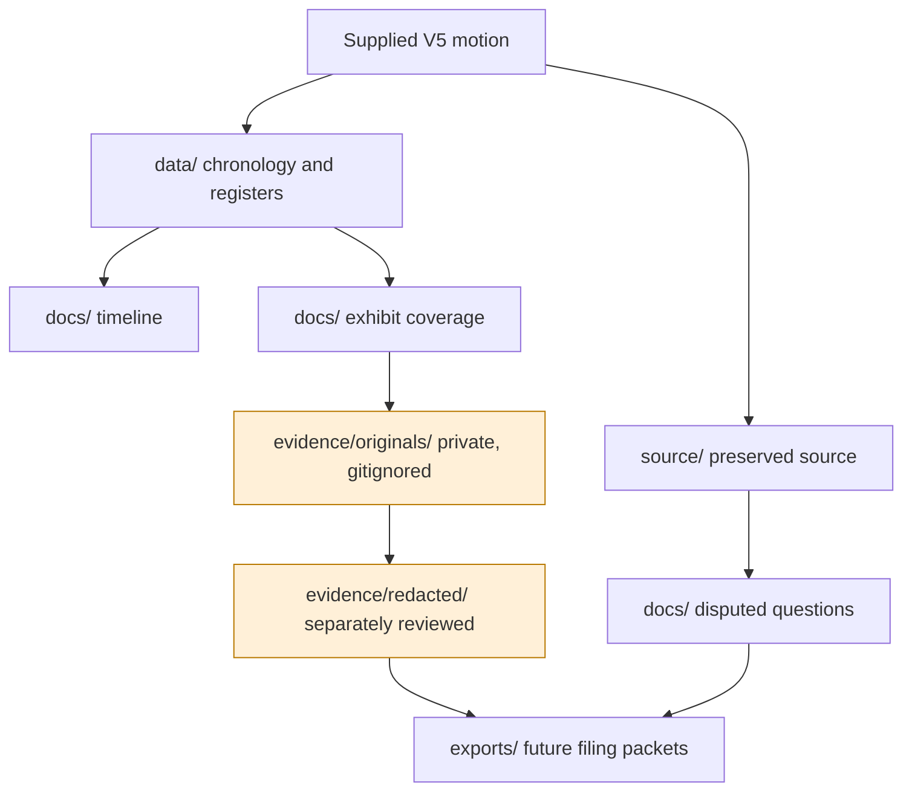

# Case 20STCV36044 — Evidence Repository (V1)

**Scope:** Structured Markdown repository derived from the supplied **Master Evidentiary Motion and Complete Factual Packet — V5**. This repository organizes source descriptions; it **does not authenticate** referenced filings, releases, medical PDFs, original documents, timestamps, or financial transactions.

> **Review status:** Attorney-review and exhibit-assembly draft. Not a court filing or a public medical-record repository. Preserve unmodified originals outside Git. Verify procedural posture and legal citations before filing.

## Repository map

## Start here

1. [Chronological record](docs/TIMELINE.md) — key events, differing timestamp meanings, and visual timeline.
2. [Claim and authority map](docs/ISSUE_MAP.md) — separate plaintiffs, legal questions, and proof paths.
3. [Exhibit coverage](docs/EXHIBITS.md) — what each proposed exhibit should establish and what is missing.
4. [Provenance and verification](docs/PROVENANCE.md) — original → page → fact → limitation → filing.
5. [Medical chronology](docs/MEDICAL_SOURCES.md) — 25 *reported* PDF entries and significant time distinctions.
6. [Workflow](docs/WORKFLOW.md) — workstream, statuses, checks, and privacy safeguards.
7. [Full source motion V5](source/MASTER_EVIDENTIARY_MOTION_V5.md).

## Data

| File | Description |
|---|---|
| `data/chronology.csv` / `.json` | Source V5 time-locked event register; includes source classifications and limits. |
| `data/exhibit_matrix.csv` | Proposed exhibits and open authentication needs. |
| `data/medical_source_register.csv` | 25 medical sources and **unverified hashes reported in extracts**. |
| `data/source_manifest.json` | SHA-256 of the actual supplied V5 text; extraction counts. |

Run `python scripts/validate.py` to check parse counts, IDs, and SHA-256 of the preserved V5 source against the manifest. Validation establishes internal consistency **only**, not truth of content or authenticity of absent documents.

### Privacy and disclosure

Do not commit raw clinical PDFs, identities, personal health information, bank records, or native messages to a public Git repository. `evidence/originals/` and `evidence/redacted/` are ignored. Redactions and privilege review must precede public exhibits. Preserve original bytes and separate all derived working copies. See [PROVENANCE](docs/PROVENANCE.md).
