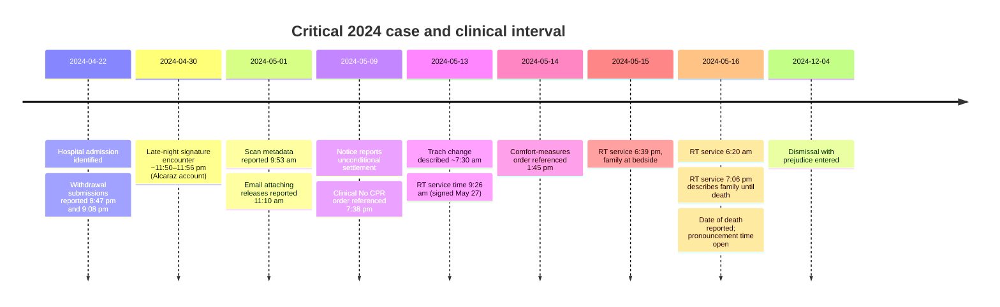
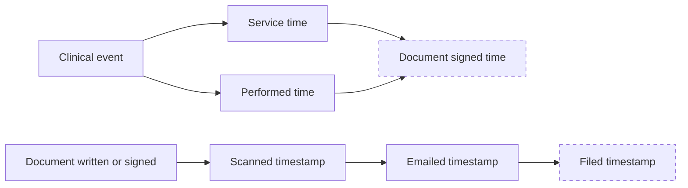

# Chronology and temporal distinctions

The timeline uses the **times as described in the V5 source**, not independent docket or PDF verification. Approximate, retrospective, service, performed, signed, scan and filing times must not be conflated.

## Separate kinds of time

A service or signature timestamp is **not automatically** an actual event time. In particular, the May 16 7:06 pm respiratory note is not certified time of death; May 1 9:53 am scan metadata is not proof of when an additional handwritten signature appeared.

## Complete event register

| Date/time (Pacific) | Event | Source type | Meaning / limit |
|---|---|---|---|
| 2019-10-07, time not supplied | Buttelman medical statement | DOCUMENT | Pre-event baseline; not an accident-causation finding. |
| 2019-10-08, 1:20 p.m. electronic signature | ED note describing wheelchair fall and clinical assessment | DOCUMENT | Signature time, not necessarily time of bus occurrence. |
| 2020-02-24 to 2020-02-27 | Admission and CT findings concerning pelvic insufficiency fractures | DOCUMENT | Injury/treatment history; medical causation unresolved. |
| 2020-09-21 | Complaint filed for separate plaintiffs | DOCUMENT | Litigation begins. |
| 2020-09-28 | GAL-related special status on register | DOCUMENT | Obtain actual appointment order and scope. |
| 2024-04-22, admission time open | Rodriguez admitted | DOCUMENT (later clinical reporting) | Same day as withdrawals, not proof of counsel's clinical knowledge. |
| 2024-04-22, 8:47 p.m. | Alcaraz withdrawal submission | DOCUMENT DESCRIPTION | Verify docket time zone and filed original. |
| 2024-04-22, 9:08 p.m. | Rodriguez withdrawal submission | DOCUMENT DESCRIPTION | Verify service and representative caption. |
| 2024-04-24 | Multiple seizures and dialysis described in later note | DOCUMENT (retrospective) | Later report is not an April 24 signed note. |
| 2024-04-29 | Lumbar puncture reported in later notes | DOCUMENT (retrospective) | Exact time not established here. |
| 2024-04-30, approx. 11:50–11:56 p.m. | Two instruments signed, immediate refusal, originals retained by Levin | ALCARAZ ACCOUNT | Exact minutes and sequence require declarant and witnesses. |
| 2024-05-01, 9:53 a.m. | Reported scan timestamp | METADATA DESCRIPTION | Not necessarily handwritten signature time. |
| 2024-05-01, 11:10 a.m. | Email transmitting two PDF releases | DOCUMENT DESCRIPTION | Retrieve native email plus attachments and headers. |
| 2024-05-05, 5:00 p.m. | CRRT initiation described retrospectively | DOCUMENT (retrospective) | ICU escalation dated May 4/5 in different reports. |
| 2024-05-09, filing time to be verified | Notice of unconditional settlement | DOCUMENT | Report of settlement, not court approval by itself. |
| 2024-05-09, 7:38 p.m. | No CPR order referenced in ICU records | DOCUMENT | Clinical order; unrelated to proof of settlement consent. |
| 2024-05-13, ~7:30 a.m. | Trach exchange recounted by respiratory therapist | DOCUMENT | Approximate procedure time inside later note. |
| 2024-05-13, 7:57 a.m. | ENT service-time report | DOCUMENT | Service-time field; first trach change described. |
| 2024-05-13, 9:26 a.m. | Respiratory-therapy service-time report | DOCUMENT | Performed 9:28 a.m.; signed May 27 6:53 p.m. |
| 2024-05-13/14 | Goals-of-care discussion/comfort-care transition | DOCUMENT (retrospective) | Different documents reflect different stages and dates. |
| 2024-05-14, 1:45 p.m. | Comfort-measures order referenced | DOCUMENT | Distinct from family discussion date. |
| 2024-05-15, 6:39 p.m. | RT report notes comfort care and family at bedside | DOCUMENT | Signed 6:46 p.m. |
| 2024-05-16, 6:20 a.m. | RT care/alarms adjusted for comfort settings | DOCUMENT | Signed 6:22 a.m. |
| 2024-05-16, 7:06 p.m. | RT report describes family at bedside until death | DOCUMENT | Service time, **not certified time of death**; signed 7:08 p.m. |
| 2024-05-16, pronouncement time open | Death of Rodriguez | DOCUMENT DESCRIPTION | Obtain death certificate/pronouncement record. |
| 2024-05-17, 10:00 a.m. (previously set) | Final status conference | DOCKET DESCRIPTION | Check vacation order and who was notified. |
| 2024-05-29, 1:30 p.m. (previously set) | Withdrawal hearing | DOCKET DESCRIPTION | Check vacation order. |
| 2024-05-31, 8:30 a.m. (previously set) | Jury trial | DOCKET DESCRIPTION | Check vacation order, service and notice. |
| 2024-12-03 | Dismissal request submitted | DOCUMENT DESCRIPTION | Examine who signed and asserted authority. |
| 2024-12-04 | Dismissal entered with prejudice | DOCUMENT DESCRIPTION | Court act acknowledged; authority contested. |
| 2025-12-02 | Motion to vacate filed | PRIOR CASE HISTORY | Preserve full filing and disposition in the packet. |
| 2026-09-24 / 2026-11-04 | Defense papers identified in user chronology | PRIOR CASE HISTORY | Include exact titles, contents and docket dates after matching originals. |
