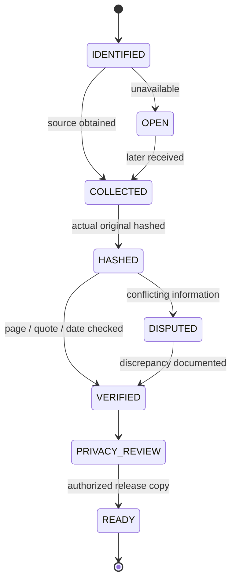

# Review and assembly workflow

## Review gates

| Gate | Completion criterion |
|---|---|
| Source | Exact physical or native document identified; source custody logged. |
| Metadata | Hash computed for actual bytes, type and timezone of dates identified. |
| Attribution | Documentary quotation, personal account, and open inference separated. |
| Disputed proof | Conflicting documents and contrary evidence documented, not discarded. |
| Procedural | Full 2025–2026 papers and all relevant court rulings assembled and reviewed. |
| Privacy | Protected material redacted / sealing rules reviewed before distribution. |
| Filing | Standing, notice, service, declarations and court formatting reviewed by qualified counsel. |

Run `python scripts/validate.py` after edits to check structured extract integrity. It cannot determine admissibility or legal sufficiency.
